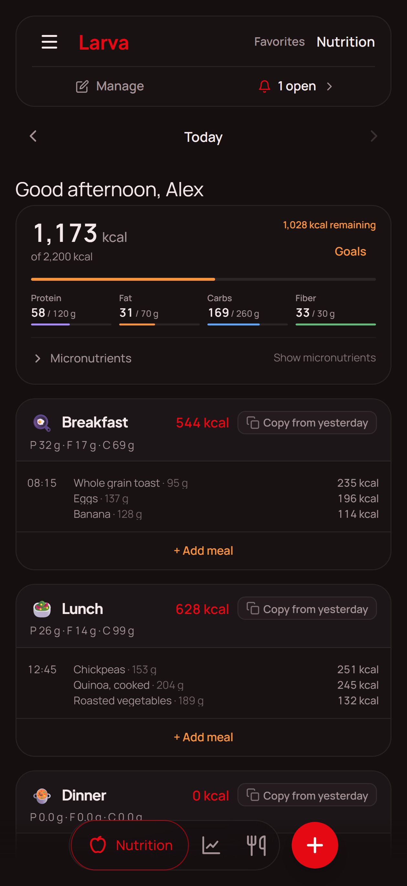
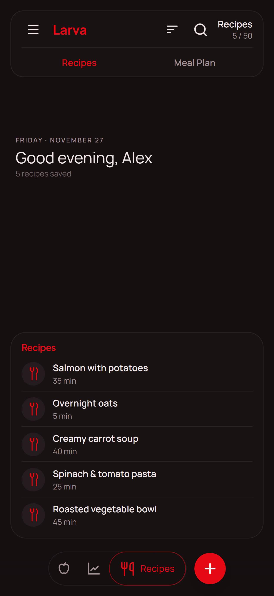

# Larva

<p align="center">
  
</p>

<p align="center">
  <strong>Self-hosted, offline-first PWA for nutrition tracking, supplements and daily health habits, with recipes and weekly meal planning.</strong>
</p>

<p align="center">
  
  
  
  
  
  
  
</p>

---

Larva opens on your nutrition diary. Below the meals, a daily log collects supplements, water, caffeine, mood and meditation, and one date picker moves the whole screen to any earlier day. History turns those entries into weekly, monthly and yearly trends.

Everything runs on your own server. The trackers keep working offline through IndexedDB and sync when the connection returns. Navigation and the `+` button sit at the bottom of the screen, within thumb reach, and Larva installs as a **Progressive Web App** on phones and desktops.

---

## Table of Contents

- [Features](#features)
  - [Nutrition Home & Food Diary](#nutrition-home--food-diary)
  - [Daily Log & Trackers](#daily-log--trackers)
  - [History & Reports](#history--reports)
  - [Recipes & Meal Planning](#recipes--meal-planning)
  - [Settings, Ergonomics & PWA](#settings-ergonomics--pwa)
- [Architecture & Tech Stack](#architecture--tech-stack)
- [Local Development](#local-development)
- [Deployment](#deployment)
  - [Docker Compose](#docker-compose)
  - [Upgrading & Backups](#upgrading--backups)
  - [Environment Variables](#environment-variables)
  - [HTTPS Requirement](#https-requirement)
  - [Push Notifications (Web Push)](#push-notifications-web-push)
  - [Admin Password Recovery](#admin-password-recovery)
- [User Management & Security](#user-management--security)
- [Automated Maintenance](#automated-maintenance)

---

## Features

### Nutrition Home & Food Diary

<table align="center">
  <thead>
    <tr>
      <th align="center">Home</th>
      <th align="center">Log Meal</th>
      <th align="center">Goals</th>
    </tr>
  </thead>
  <tbody>
    <tr>
      <td align="center"></td>
      <td align="center"></td>
      <td align="center"></td>
    </tr>
  </tbody>
</table>

- **Home screen:** today's calories and macros against your goals, the meals of the day (breakfast, lunch, dinner, snacks or your own subdivisions) and the daily log underneath. The date arrows switch the whole screen to another day, so you can review or complete earlier days.
- **Food search:** 160+ built-in generic foods (searchable in German, English and Spanish) plus branded products from [Open Food Facts](https://world.openfoodfacts.org/) by name or barcode, with Nutri-Score and Nova group. Products that list energy only in kJ are converted to kcal, and lookups are cached in SQLite.
- **Barcode scanner:** the native [BarcodeDetector API](https://developer.mozilla.org/en-US/docs/Web/API/BarcodeDetector) on Chromium/Android, with a [ZBar WebAssembly](https://github.com/undecaf/zbar-wasm) fallback on iOS and Firefox.
- **AI estimates (optional):** estimate a meal from a description or photo, or read a nutrition label, with your own Gemini or OpenAI API key.
- **Micronutrients:** potassium, calcium, magnesium, iron, sodium and vitamins A, B6, B12, C and D per food and per day, with fat types.
- **Favourites and templates:** save single foods or whole meals, copy a meal from yesterday, and attach a photo.
- **Goal calculator:** set targets by hand or estimate them with Mifflin-St Jeor from your body data, activity, goal (fat loss, maintenance, muscle gain) and diet (balanced, high protein, low carb, keto). The form warns when your macros do not add up to the calorie goal.

---

### Daily Log & Trackers

<table align="center">
  <thead>
    <tr>
      <th align="center">Daily Log</th>
      <th align="center">Quick Log</th>
      <th align="center">Supplements</th>
    </tr>
  </thead>
  <tbody>
    <tr>
      <td align="center"></td>
      <td align="center"></td>
      <td align="center"></td>
    </tr>
  </tbody>
</table>

- **Supplements:** one-tap intake logging, nutrients per unit (for example 200 mg magnesium per capsule), stock tracking and weekly reminder schedules.
- **Hydration:** quick presets, a daily goal and interval reminders within a time window.
- **Caffeine:** a drink catalog with editable servings, a daily limit, and drinks logged automatically from saved meals.
- **Meditation:** a full-screen timer with preparation countdown and start/end sounds, or sessions logged afterwards.
- **Mood:** a 1–5 rating with energy, activity tags, a note and gratitude, plus an optional weekly review.
- **Logging on past days:** the quick log follows the date shown on the home screen, so missed entries can be added later.
- **Reminders:** Web Push reminders for supplements, water, meditation and mood. A reminder skipped by a restart or a late timer is caught up for up to 15 minutes.
- **Offline:** tracker entries are written to IndexedDB first and synced in order once online; two open tabs never sync at the same time.

---

### History & Reports

<table align="center">
  <thead>
    <tr>
      <th align="center">Week</th>
      <th align="center">Month</th>
      <th align="center">Year</th>
    </tr>
  </thead>
  <tbody>
    <tr>
      <td align="center"></td>
      <td align="center"></td>
      <td align="center"></td>
    </tr>
  </tbody>
</table>

- **Week and month:** a chart per category (calories with goal line, water, caffeine with limit, meditation), macro distribution, mood calendar and supplement adherence. Days without entries show as empty slots, never as low values.
- **Honest numbers:** averages count only logged days and always say how many ("Ø 2,000 kcal · 5 of 7 days logged"). A comparison with the previous period appears only when both periods have enough logged days.
- **Year:** a calendar heatmap of the 12 months. The default view shows how many of your categories you logged each day, which measures consistency, not health. Each category can also be shown on its own, with monthly averages underneath.
- **Food micronutrients:** monthly and yearly values shown as minimums with the share of calories that has data, because a missing value is not a zero.
- **Drill-down:** tapping any day in a chart or the calendar opens it on the home screen; going back returns to the same place in History.
- **PDF export:** printer-friendly reports of supplements, trackers, mood and nutrients for any date range.

Goals, limits and supplement schedules are stored without history, so percentages for past periods use the current settings; History says so on screen.

---

### Recipes & Meal Planning

<table align="center">
  <thead>
    <tr>
      <th align="center">Recipes</th>
      <th align="center">Recipe Details</th>
      <th align="center">Meal Planner</th>
    </tr>
  </thead>
  <tbody>
    <tr>
      <td align="center"></td>
      <td align="center"></td>
      <td align="center"></td>
    </tr>
  </tbody>
</table>

- **Recipe library:** up to 50 recipes per user with photos, ratings, tags, prep and cook times.
- **Import from the web:** paste a URL to import ingredients, steps, servings and image from recipe sites that publish schema.org data.
- **Cooking:** servings scale every amount, including fractions and ranges, and the screen can stay awake while you cook.
- **Nutrition per serving:** map ingredients to foods once, then log servings straight into the food diary.
- **Sharing:** send a recipe to another user of your instance.
- **Weekly meal planner:** plan several dishes per day and adjust servings per entry.

---

### Settings, Ergonomics & PWA

<table align="center">
  <thead>
    <tr>
      <th align="center">Settings</th>
      <th align="center">Menu</th>
    </tr>
  </thead>
  <tbody>
    <tr>
      <td align="center"></td>
      <td align="center"></td>
    </tr>
  </tbody>
</table>

- **Bottom navigation:** Nutrition, History and Recipes, plus a `+` button that opens the quick log.
- **Shortcuts:** long-press `+` for up to 4 shortcuts (log a meal, supplement, water, caffeine, mood or meditation). Notifications and shortcuts open the right sheet directly.
- **Modular trackers:** hide water, caffeine, mood or meditation, and the Recipes tab, when you do not use them.
- **Themes:** light, dark or system, with several accent colours and a light or dark app icon.
- **Languages:** English and German via [Paraglide JS](https://inlang.com/m/gerre34r/library-inlang-paraglideJs).

---

## Architecture & Tech Stack

```
┌─────────────────────────────────────────────────────────────┐
│                       Client (PWA)                          │
│  SvelteKit 3.1 (Svelte 5 runes) + Tailwind CSS v4           │
│  Service worker + IndexedDB (Dexie) offline queue           │
└──────────────────────────────▲──────────────────────────────┘
                               │ HTTPS (REST / Web Push)
┌──────────────────────────────▼──────────────────────────────┐
│                    Server (Node.js 24)                      │
│  SvelteKit Node adapter, scrypt auth + hashed sessions      │
│  Reminder scheduler, pre-upgrade backups, daily cleanup     │
└──────────────────────────────▲──────────────────────────────┘
                               │ better-sqlite3 (WAL)
┌──────────────────────────────▼──────────────────────────────┐
│                  Database (SQLite)                          │
│  Drizzle ORM + migrations applied at startup                │
└─────────────────────────────────────────────────────────────┘
```

| Component | Technology | Role |
| :--- | :--- | :--- |
| **Frontend** | SvelteKit 3.1 & Svelte 5 | Runes-only reactivity (`$state`, `$derived`, `$props`, `$effect`). |
| **Styling** | Tailwind CSS v4 | Utility styling with theme tokens. |
| **Icons** | `@lucide/svelte` | Icon set. |
| **Offline storage** | Dexie (IndexedDB) + service worker | Account-scoped offline mirrors and a FIFO mutation queue. |
| **Concurrency** | Web Locks API | Only one tab drains the queue at a time. |
| **Barcodes** | BarcodeDetector API + ZBar WASM | Native decoding with a WebAssembly fallback. |
| **Server** | Node.js 24 (Alpine image) | ESM backend. |
| **Database** | SQLite via `better-sqlite3` | Embedded transactional storage. |
| **ORM** | Drizzle ORM | Typed schema, queries and migrations. |
| **Push** | Web Push (`web-push`) | Reminders. |
| **Reports** | pdfmake | PDF export. |
| **Localization** | Paraglide JS | Compile-time translations (English, German). |

---

## Local Development

### Prerequisites

- **Node.js:** `>=24 <25`
- **npm:** `>=10`
- C++ build tools, only if `better-sqlite3` has no prebuilt binary for your platform.

### Setup

```bash
git clone https://github.com/Matikd9/Larva.git larva
cd larva
npm ci            # install from the lockfile
npm run prepare   # compile translations and sync SvelteKit types
npm run dev       # http://localhost:5173
```

On the first start, set `ADMIN_USERNAME` and `ADMIN_PASSWORD` (for example in a `.env` file) to create the administrator.

### Checks

```bash
npm run check              # svelte-check, must report zero warnings
npm run test               # Vitest unit and integration tests
npm run build              # production build, fails on any warning
npm run test:release       # release-policy and upgrade-comparison scripts
npm run test:dependencies  # vendored drizzle-kit + migration generator check
npm run test:browser       # Playwright (Chromium + WebKit), needs Docker and GROLY_TEST_IMAGE
npm run test:docker        # Docker upgrade-path verification
```

Browser tests run against a built image, not the dev server: `docker build -t larva:test .`, then run the suite with `GROLY_TEST_IMAGE=larva:test`.

---

## Deployment

### Docker Compose

```yaml
services:
  larva:
    image: matikd19/larva:latest
    container_name: larva
    restart: unless-stopped
    ports:
      - "3000:3000"
    volumes:
      - ./data:/app/data
    environment:
      - ORIGIN=https://larva.example.com
      - ADMIN_USERNAME=admin
      - ADMIN_PASSWORD=ChangeMeImmediately123!
      # Optional: Web Push
      - VAPID_PUBLIC_KEY=
      - VAPID_PRIVATE_KEY=
      - PUBLIC_VAPID_PUBLIC_KEY=
      - VAPID_SUBJECT=mailto:admin@example.com
    healthcheck:
      test: ["CMD-SHELL", "wget -qO- http://localhost:3000/api/health || exit 1"]
      interval: 30s
      timeout: 5s
      retries: 3
      start_period: 10m
```

```bash
docker compose up -d
```

The long `start_period` matters: before migrating after an update, Larva copies the database and all uploaded images, and `/api/health` answers 503 until that finishes. Variables can also live in an `.env` file referenced with `env_file`. Step-by-step guides for NAS systems are in [`docs/`](docs) (Portainer, QNAP, Synology, TrueNAS, Unraid).

### Upgrading & Backups

```bash
docker compose pull
docker compose up -d
```

On the first start of a new version, Larva writes a verified snapshot of the database and the `uploads` folder to `data/backups/<timestamp>-<version>-<id>/` before running migrations. Keep your own copy of the data volume as well; an automatic backup on the same disk does not protect against losing the disk. Restoring, disk space and release notes that delete data (version 1.1.0 removes the former shopping lists) are covered in [`docs/UPGRADING.md`](docs/UPGRADING.md).

---

### Environment Variables

| Variable | Default | Description |
| :--- | :--- | :--- |
| `ORIGIN` | *Required in production* | Public URL, e.g. `https://larva.example.com`. |
| `PORT` | `3000` | Internal HTTP port. |
| `DATABASE_URL` | `/app/data/groly.db` | SQLite file; `uploads/` and `backups/` live next to it. |
| `BODY_SIZE_LIMIT` | `15M` | Maximum request size for uploads and recipe imports. |
| `ADMIN_USERNAME` | `admin` | Administrator created on the first start. |
| `ADMIN_PASSWORD` | *Empty* | Required on the first start only; ignored once users exist. |
| `ADMIN_PASSWORD_RESET` | *Empty* | Temporary: resets the password of `ADMIN_USERNAME` on start. |
| `VAPID_PUBLIC_KEY` | *Empty* | Public VAPID key for Web Push. |
| `PUBLIC_VAPID_PUBLIC_KEY` | *Empty* | Same value as `VAPID_PUBLIC_KEY`, used by the browser. |
| `VAPID_PRIVATE_KEY` | *Empty* | Private VAPID key. |
| `VAPID_SUBJECT` | *Empty* | Contact URI (`mailto:` or `https://`) required by push services. |
| `GEMINI_API_KEY` | *Empty* | Optional server-wide fallback for AI estimates when a user has no key. |
| `OPENAI_API_KEY` | *Empty* | Same, for OpenAI. |
| `OFF_COUNTRY` | *Empty* | Restricts Open Food Facts text search to one country (e.g. `chile`). |
| `OFF_PREFERRED_BARCODE_PREFIX` | `780` | Barcode prefix (GS1 country) ranked higher in food search; empty disables it. |
| `OFF_PREFERRED_COUNTRY` | `chile` | Open Food Facts country ranked higher in food search; empty disables it. |

The database keeps its historical name `groly.db` (Groly is the internal package name); renaming it is not needed.

---

### HTTPS Requirement

HTTPS is required, also on a home network:

| Capability | Why |
| :--- | :--- |
| **Offline cache** | Service workers only register on secure origins. |
| **PWA installation** | Browsers require HTTPS for "Add to Home Screen". |
| **Push notifications** | Web Push requires a secure context. |
| **Barcode scanner** | Camera access is limited to HTTPS. |
| **Session cookies** | Cookies carry the `Secure` flag in production. |

Easy options: **Tailscale** HTTPS certificates, a **Cloudflare Tunnel**, or a reverse proxy such as **Caddy**, **Nginx Proxy Manager** or **Traefik**.

---

### Push Notifications (Web Push)

1. Generate a VAPID key pair:
   ```bash
   npx web-push generate-vapid-keys
   ```
2. Set `VAPID_PUBLIC_KEY`, `PUBLIC_VAPID_PUBLIC_KEY` (same value) and `VAPID_PRIVATE_KEY`.
3. Set `VAPID_SUBJECT` to a contact address, then turn on notifications in *Settings*.

---

### Admin Password Recovery

1. Add `ADMIN_PASSWORD_RESET=YourNewTemporaryPassword123!` to the environment, and make sure `ADMIN_USERNAME` matches the existing admin.
2. Recreate the container with `docker compose up -d` (a plain `restart` does not pick up new variables). The log confirms the reset, and all of that admin's sessions are closed.
3. Sign in, then remove `ADMIN_PASSWORD_RESET` and recreate the container again; otherwise the password is reset on every start.

---

## User Management & Security

- **Invitations only:** there is no public registration. Administrators add users in *Menu → Users*; each user sets a password through a one-time link valid for 48 hours. Password resets work the same way.
- **Passwords and sessions:** passwords are hashed with scrypt. Sessions are stored as SHA-256 hashes, so a copy of the database contains no usable session tokens.
- **Rate limits:** sign-in attempts, AI requests (30 per 15 minutes), image uploads (60 per 15 minutes) and recipe sharing (20 per 15 minutes).
- **Uploads:** images are accepted by their actual file content (JPEG, PNG, GIF, WebP, AVIF, HEIC), up to 5 MB.
- **Account switching:** API calls carry the signed-in user, and the offline cache is separated per account, so switching accounts on one device never mixes data or replays someone else's queued changes.

---

## Automated Maintenance

Larva cleans up at startup and then every 24 hours:

- **Sessions and invitations:** expired sessions, used invitations and links expired more than 30 days ago.
- **Meal plan:** entries older than 6 months.
- **Barcode cache:** products not looked up for 6 months, except ones a user corrected.
- **Unused images:** uploads that no recipe, meal or favourite references any more, once older than a day.
- **Push subscriptions:** endpoints that report 404/410 are removed when a notification is sent.

---

## License

This project is open-source software licensed under the MIT License.
