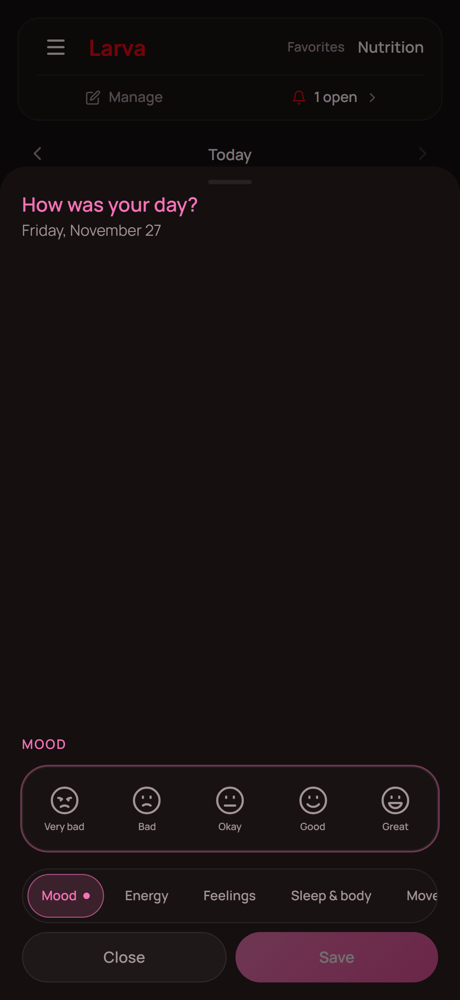
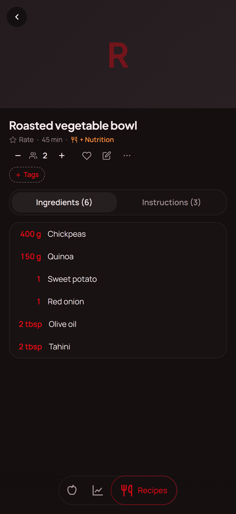

# Larva

<p align="center">
  
</p>

<p align="center">
  <strong>Self-hosted, offline-first application for grocery shopping lists, recipes, weekly meal planning, health and nutrition tracking.</strong>
</p>

<p align="center">
  
  
  
  
  
  
  =24" />
</p>

---

Larva is a privacy-first, self-hosted web application designed from the ground up for mobile ergonomics. Navigation and high-frequency actions stay anchored at the bottom of the screen within comfortable thumb reach, allowing you to rapidly add, organize, and check off items while on the move.

Shopping lists and habit trackers work **offline-first** through IndexedDB and sync automatically with the server when network connectivity is available. You can share lists with other family members or roommates to shop collaboratively, with state updates synchronized in real time via Server-Sent Events (SSE).

Install Larva on your phone or desktop as a **Progressive Web App (PWA)** for a seamless native-app feel, or run it through your preferred browser.

---

## Table of Contents

- [Features](#features)
  - [Shopping Lists](#shopping-lists)
  - [Daily Tracker & Habits](#daily-tracker--habits)
  - [Nutrition Tracker & Food Diary](#nutrition-tracker--food-diary)
  - [Recipes & Meal Planning](#recipes--meal-planning)
  - [Settings, Ergonomics & PWA](#settings-ergonomics--pwa)
- [Architecture & Tech Stack](#architecture--tech-stack)
- [Local Development](#local-development)
- [Deployment](#deployment)
  - [Docker Compose](#docker-compose)
  - [Environment Variables](#environment-variables)
  - [HTTPS Requirement](#https-requirement)
  - [Push Notifications (Web Push)](#push-notifications-web-push)
  - [Admin Password Recovery](#admin-password-recovery)
- [User Management & Security](#user-management--security)
- [Automated Database Maintenance](#automated-database-maintenance)

---

## Features

### Shopping Lists

<table align="center">
  <thead>
    <tr>
      <th align="center">Overview</th>
      <th align="center">Shopping List</th>
      <th align="center">Favourites</th>
    </tr>
  </thead>
  <tbody>
    <tr>
      <td align="center"></td>
      <td align="center"></td>
      <td align="center"></td>
    </tr>
  </tbody>
</table>

- **Shared Collaborative Lists:** Share any list with other household members. State changes sync in real time using Server-Sent Events (SSE).
- **Offline-First & Concurrency-Safe:** Add, check off, edit, or delete items completely offline. The background mutation queue synchronizes automatically upon reconnecting, protected against multi-tab race conditions via the **Web Locks API**.
- **Integrated Barcode Scanner:** Scan barcodes with your mobile camera to quickly identify and append items. Powered by the native [BarcodeDetector API](https://developer.mozilla.org/en-US/docs/Web/API/BarcodeDetector) on Chromium/Android with a high-performance [ZBar WebAssembly](https://github.com/undecaf/zbar-wasm) fallback on iOS and Firefox.
- **Open Food Facts Integration:** Product metadata is looked up against [Open Food Facts](https://world.openfoodfacts.org/), [Open Products Facts](https://world.openproductsfacts.org/), and [Open Beauty Facts](https://world.openbeautyfacts.org/) without exposing client IPs or requiring third-party API keys. Lookups are cached persistently in SQLite.
- **Smart Category Sorting:** Items are automatically categorized by keyword matching (e.g. *"milk"* → Dairy, *"apple"* → Produce). Category order can be reordered globally or individually per list to reflect your local supermarket layout.
- **Quick Entry:** Add multiple items in a single input string separated by commas (e.g., `2x Oat Milk, 500g Pasta, Apples`). Quantities and units are parsed automatically.
- **Usage Frequency Suggestions:** Item inputs suggest previously purchased items ranked by personal frequency. Suggestion history is maintained per user.
- **Swipe to Peek:** Swipe horizontally on truncated product names to read the full description in an overlay without accidentally checking the item off.
- **Favourites Panel:** Bookmark frequent staples with a single tap to rapidly replenish lists across grocery runs.

---

### Daily Tracker & Habits

<table align="center">
  <thead>
    <tr>
      <th align="center">Today Overview</th>
      <th align="center">Quick Log</th>
      <th align="center">Weekly History</th>
    </tr>
  </thead>
  <tbody>
    <tr>
      <td align="center"></td>
      <td align="center"></td>
      <td align="center"></td>
    </tr>
  </tbody>
</table>

<table align="center">
  <thead>
    <tr>
      <th align="center">Tracker Log</th>
      <th align="center">Mood & Gratitude</th>
      <th align="center">Monthly History</th>
    </tr>
  </thead>
  <tbody>
    <tr>
      <td align="center"></td>
      <td align="center"></td>
      <td align="center"></td>
    </tr>
  </tbody>
</table>

- **Supplements & Nootropics:** One-tap quick intake logging. Define nutrient breakdowns per unit (e.g., 200 mg Magnesium per capsule); Larva calculates your aggregated daily micronutrient totals. Track inventory stock levels with direct reorder buttons that send items to your shopping list.
- **Hydration Tracking:** Quick-log water intake with customizable presets, track progress towards your daily milliliter goal, and schedule interval reminders throughout the day.
- **Caffeine Intake:** Built-in drink catalog (coffee, espresso, energy drinks, tea) with customizable default serving sizes and caffeine ratings. Visual threshold indicator alerts you when reaching your daily caffeine ceiling.
- **Meditation Timer:** Full-screen timer with calming animations, configurable preparation countdowns, soothing start/end bell acoustics, and adherence metrics.
- **Mood Journal:** Log daily mental well-being on a 1–5 scale accompanied by activity tags and gratitude reflections.
- **Adherence Metrics & PDF Export:** Comprehensive day, week, and month history views with adherence heatmaps. Generate and export polished, printer-friendly PDF clinical reports for medical professionals or trainers.

---

### Nutrition Tracker & Food Diary

<table align="center">
  <thead>
    <tr>
      <th align="center">Food Diary</th>
      <th align="center">Log Meal</th>
      <th align="center">Macro Goals</th>
    </tr>
  </thead>
  <tbody>
    <tr>
      <td align="center"></td>
      <td align="center"></td>
      <td align="center"></td>
    </tr>
  </tbody>
</table>

- **Daily Food Diary:** Log meals across the day with real-time calorie calculation and macronutrient progress rings (Protein, Carbohydrates, Fats, Fiber).
- **Dual Nutrition Database:** Search among 160+ built-in generic whole foods or query any branded item directly via the Open Food Facts barcode engine (includes Nutri-Score, Nova group, and nutritional values).
- **Estimated Energy Calculation:** Set customized targets manually or let Larva compute recommended caloric targets using the Mifflin-St Jeor metabolic expenditure algorithm based on your physical parameters.
- **Recipe Nutrition Mapping:** Map recipe ingredients to nutrition database entries once; Larva displays calculated calories per portion and enables logging prepared servings directly into your daily log.

---

### Recipes & Meal Planning

<table align="center">
  <thead>
    <tr>
      <th align="center">Recipe Catalog</th>
      <th align="center">Recipe Details</th>
      <th align="center">Meal Planner</th>
    </tr>
  </thead>
  <tbody>
    <tr>
      <td align="center"></td>
      <td align="center"></td>
      <td align="center"></td>
    </tr>
  </tbody>
</table>

- **Recipe Library & Web Scraper:** Store, tag, rate, and organize personal recipes. Import full recipes, ingredients, and instructions directly from popular cooking sites via URL.
- **Dynamic Serving Scaler:** Dynamically scale ingredient quantities by adjusting portion count.
- **Weekly Meal Planner:** Schedule meals for every day of the week. Send ingredients from a single meal or the whole week's schedule directly into any shopping list with a single tap.

---

### Settings, Ergonomics & PWA

<table align="center">
  <thead>
    <tr>
      <th align="center">Settings Page</th>
      <th align="center">Navigation Menu</th>
    </tr>
  </thead>
  <tbody>
    <tr>
      <td align="center"></td>
      <td align="center"></td>
    </tr>
  </tbody>
</table>

- **Modular Feature Toggles:** Disable unused modules (Supplements, Habits, Recipes, or Nutrition) in *Settings → Display*. Unchecked modules are hidden from navigation and menus.
- **Quick-Access Action Wheel:** Long-press the floating action button (`+`) to activate up to 4 configurable radial shortcuts (e.g., open specific lists, launch scanner).
- **Location-Aware Automatic List Opening:** Bind geographical coordinates to lists (such as your local supermarket). When entering within a 100-meter radius, Larva can automatically navigate to that list.
- **Dark & Light Mode:** Seamlessly harmonizes with operating system visual preferences.
- **Internationalization (i18n):** Native support for English and German via `@inlang/paraglide-js`.

---

## Architecture & Tech Stack

Larva is engineered for reliability, deterministic offline operation, and sub-millisecond local latency:

```
┌─────────────────────────────────────────────────────────────┐
│                       Client (PWA)                          │
│  SvelteKit 3.1 (Svelte 5 Runes) + Tailwind CSS v4           │
│  IndexedDB (Dexie.js) + Multi-Tab Web Locks Synchronization │
└──────────────────────────────▲──────────────────────────────┘
                               │ HTTPS (REST / SSE / WebPush)
┌──────────────────────────────▼──────────────────────────────┐
│                    Server (Node.js 24)                      │
│  SvelteKit Node Adapter + Server-Sent Events Engine         │
│  Custom Scrypt Authentication + Session Store               │
└──────────────────────────────▲──────────────────────────────┘
                               │ better-sqlite3 + WAL Mode
┌──────────────────────────────▼──────────────────────────────┐
│                  Database Engine (SQLite)                   │
│  Drizzle ORM + Idempotent Incremental Migrations            │
└─────────────────────────────────────────────────────────────┘
```

| Component | Technology | Role |
| :--- | :--- | :--- |
| **Frontend Framework** | SvelteKit 3.1 & Svelte 5 | Strict Runes reactivity (`$state`, `$derived`, `$props`, `$effect`). |
| **Styling** | Tailwind CSS v4 (`@tailwindcss/vite`) | Modern, lightweight, atomic styling. |
| **Icons** | `@lucide/svelte` | Clean, accessible icon system. |
| **Client Storage** | Dexie.js (IndexedDB) | Offline persistence and FIFO mutation queue. |
| **Concurrency Lock** | Web Locks API | Inter-tab exclusion to serialize queue draining. |
| **Barcode Recognition** | BarcodeDetector API + ZBar WASM | Dual-layer hardware-accelerated barcode decoding. |
| **Server Engine** | Node.js `>=24` (Alpine base) | High-performance ESM backend. |
| **Database** | SQLite via `better-sqlite3` | Zero-latency embedded transactional storage. |
| **ORM & Migrations** | Drizzle ORM (`drizzle-orm`) | Type-safe queries and schema definition. |
| **Real-time Sync** | Server-Sent Events (SSE) | Push-based multi-user list synchronization. |
| **Push Notifications** | Web Push API (`web-push`) | Background reminders and sharing updates. |
| **Localization** | Paraglide JS | Compile-time internationalization. |

---

## Local Development

### Prerequisites

- **Node.js:** `>=24.0.0 <25.0.0`
- **npm:** `>=10.0.0`
- C++ build tools (required by `better-sqlite3` compilation if prebuilt binaries are unavailable).

### Setup

```bash
# 1. Clone the repository
git clone https://github.com/peterthepeter/groly.git larva
cd larva

# 2. Install dependencies (deterministic lockfile)
npm ci

# 3. Compile i18n catalogs and sync SvelteKit types
npm run prepare

# 4. Start the Vite development server
npm run dev
```

Navigate to `http://localhost:5173`.

### Quality & Verification Pipeline

Larva enforces strict zero-warning compilation and comprehensive testing:

```bash
# Type check and Svelte diagnostic validation
npm run check

# Execute unit and integration tests (Vitest)
npm run test

# Validate vendor dependency integrity & migration generator
npm run test:dependencies

# Verify production build with zero Rollup/Vite warnings
npm run build

# Run end-to-end browser tests (Playwright)
npm run test:browser
```

---

## Deployment

### Docker Compose

The standard production deployment runs through Docker Compose:

```yaml
services:
  larva:
    image: ghcr.io/peterthepeter/groly:latest
    container_name: larva
    restart: unless-stopped
    ports:
      - "3000:3000"
    volumes:
      - larva-data:/app/data
    environment:
      - NODE_ENV=production
      - ORIGIN=https://larva.example.com
      - DATABASE_URL=/app/data/groly.db
      - BODY_SIZE_LIMIT=15M
      - ADMIN_USERNAME=admin
      - ADMIN_PASSWORD=ChangeMeImmediately123!
      # Optional: Web Push Configuration
      - VAPID_PUBLIC_KEY=
      - VAPID_PRIVATE_KEY=
      - PUBLIC_VAPID_PUBLIC_KEY=
      - VAPID_SUBJECT=mailto:admin@example.com
    healthcheck:
      test: ["CMD-SHELL", "wget -qO- http://localhost:3000/api/health || exit 1"]
      interval: 30s
      timeout: 5s
      retries: 3
      start_period: 20s

volumes:
  larva-data:
```

Launch with:

```bash
docker compose up -d
```

---

### Environment Variables

| Variable | Default | Description |
| :--- | :--- | :--- |
| `NODE_ENV` | `production` | Node runtime environment. |
| `PORT` | `3000` | Internal HTTP port. |
| `ORIGIN` | *Required in Prod* | Canonical public URL (e.g., `https://larva.yourdomain.com`). |
| `DATABASE_URL` | `/app/data/groly.db` | Path to the SQLite database file on disk. |
| `BODY_SIZE_LIMIT` | `15M` | Maximum allowed payload size for uploads and recipe imports. |
| `ADMIN_USERNAME` | `admin` | Username for the primary instance administrator. |
| `ADMIN_PASSWORD` | *Empty* | Password set on initial bootstrap (ignored once DB exists). |
| `ADMIN_PASSWORD_RESET`| *Empty* | Set temporarily to force an admin password reset on restart. |
| `VAPID_PUBLIC_KEY` | *Empty* | Public VAPID key for Web Push. |
| `PUBLIC_VAPID_PUBLIC_KEY` | *Empty* | Must match `VAPID_PUBLIC_KEY` for client consumption. |
| `VAPID_PRIVATE_KEY` | *Empty* | Private VAPID key for backend notification signing. |
| `VAPID_SUBJECT` | *Empty* | Contact URI (`mailto:` or `https://`) required by Apple/Google push servers. |

---

### HTTPS Requirement

**HTTPS is mandatory** for modern browser features and security guarantees:

| Capability | Requirement Reason |
| :--- | :--- |
| **Offline Cache** | Service Workers will not register on insecure origins. |
| **PWA Installation** | Mobile browsers enforce HTTPS for "Add to Home Screen". |
| **Push Notifications** | The Web Push API requires secure contexts. |
| **Barcode Scanner** | Camera access (`getUserMedia`) is restricted to HTTPS. |
| **Session Cookies** | Session cookies set the `Secure` flag in production. |
| **Location Tracking** | Geolocation APIs are disabled over plain HTTP. |

#### Obtaining HTTPS

- **Tailscale (Easiest):** Enable HTTPS in the Tailscale Admin Console for automated Let's Encrypt certificates without opening ports.
- **Cloudflare Tunnel:** Zero-port tunnel providing managed HTTPS termination.
- **Reverse Proxy:** Terminate SSL with **Caddy**, **Nginx Proxy Manager**, or **Traefik**.

---

### Push Notifications (Web Push)

To enable push notifications for list updates and supplement reminders:

1. Generate a valid VAPID keypair:
   ```bash
   npx web-push generate-vapid-keys
   ```
2. Assign the output keys to `VAPID_PUBLIC_KEY`, `PUBLIC_VAPID_PUBLIC_KEY`, and `VAPID_PRIVATE_KEY` in your environment.
3. Configure `VAPID_SUBJECT` with your administrative email address.

---

### Admin Password Recovery

If the administrator password is lost:

1. Add `ADMIN_PASSWORD_RESET=YourNewTemporaryPassword123!` to the container environment.
2. Restart the container. Larva resets the admin account password on boot and invalidates existing sessions.
3. Log in with the new credentials and remove the environment variable from your configuration.

---

## User Management & Security

Larva operates under a **private invitation model**:
- There is **no public registration**.
- Administrators create users through the web interface (*Menu → Users → Add User*).
- An invitation link valid for **48 hours** is generated for the new user to securely set their password upon first access.
- Passwords are salted and hashed using **scrypt** with memory-hard parameters.

---

## Automated Database Maintenance

Larva executes an automated daily housekeeping routine at midnight to keep SQLite storage compact:

- **Checked Items:** Automatically removed after **60 days**.
- **Item Suggestions:** Suggestion index purged after **6 months** of inactivity.
- **Barcode Cache:** Product lookup cache pruned after **6 months** without access.
- **Session Tokens:** Expired authentication sessions purged daily.
- **Stale Push Subscriptions:** Dead endpoints returning HTTP 404/410 are automatically deregistered.

---

## License

This project is open-source software licensed under the MIT License.
